# Poly Haven: Food & Kitchen models

**35 assets from [Poly Haven](https://polyhaven.com), dedicated to the public domain under [CC0](https://polyhaven.com/license).** Use them in any game, free or paid, and change them however you like; no credit is needed.

3D models as glTF at 1K and 2K texture resolution, each folder self-contained (`.gltf`, `.bin`, `textures/`). 274.8 MB in all.

This is a copy kept by [zuujis-cc0](https://github.com/zuujis-cc0) so game makers can take single files from GitHub. It is not made by or affiliated with Poly Haven: the originals, often in more formats and higher resolutions, are on [polyhaven.com](https://polyhaven.com). If they help you, consider [supporting Poly Haven](https://www.patreon.com/polyhaven/overview).

Every file is listed in [MANIFEST.tsv](MANIFEST.tsv) with its size and SHA-256. More free assets: [the Zuujis collection](https://github.com/zuujis-cc0/free-game-assets#readme).

| | | | |
| :-: | :-: | :-: | :-: |
|  <b><a href="bananas">Bananas</a></b> by Alexander Shulha · <a href="https://polyhaven.com/a/bananas">source</a> |  <b><a href="brass_goblets">Brass Goblets</a></b> by Tina · <a href="https://polyhaven.com/a/brass_goblets">source</a> |  <b><a href="brass_pan_01">Brass Pan 01</a></b> by Rico Cilliers · <a href="https://polyhaven.com/a/brass_pan_01">source</a> |  <b><a href="brass_pot_01">Brass Pot 01</a></b> by Rico Cilliers · <a href="https://polyhaven.com/a/brass_pot_01">source</a> |
|  <b><a href="brass_pot_02">Brass Pot 02</a></b> by Rico Cilliers · <a href="https://polyhaven.com/a/brass_pot_02">source</a> | <a href="carrot_cake">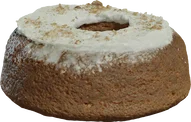</a> <b><a href="carrot_cake">Carrot Cake</a></b> by Greg Zaal, James Ray Cock · <a href="https://polyhaven.com/a/carrot_cake">source</a> | <a href="carved_wooden_plate">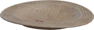</a> <b><a href="carved_wooden_plate">Carved Wooden Plate</a></b> by Jan Martens · <a href="https://polyhaven.com/a/carved_wooden_plate">source</a> |  <b><a href="ceramic_pot">Ceramic Pot</a></b> by Aron Łyczek · <a href="https://polyhaven.com/a/ceramic_pot">source</a> |
|  <b><a href="croissant">Croissant</a></b> by Dario Barresi, Greg Zaal · <a href="https://polyhaven.com/a/croissant">source</a> | <a href="food_apple_01">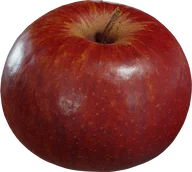</a> <b><a href="food_apple_01">Food Apple 01</a></b> by Oliver Harries · <a href="https://polyhaven.com/a/food_apple_01">source</a> |  <b><a href="food_avocado_01">Food Avocado 01</a></b> by Oliver Harries · <a href="https://polyhaven.com/a/food_avocado_01">source</a> |  <b><a href="food_ginger_01">Food Ginger 01</a></b> by Oliver Harries · <a href="https://polyhaven.com/a/food_ginger_01">source</a> |
| <a href="food_kiwi_01">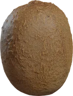</a> <b><a href="food_kiwi_01">Food Kiwi 01</a></b> by Oliver Harries · <a href="https://polyhaven.com/a/food_kiwi_01">source</a> | <a href="food_lime_01">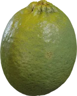</a> <b><a href="food_lime_01">Food Lime 01</a></b> by Oliver Harries · <a href="https://polyhaven.com/a/food_lime_01">source</a> | <a href="food_lychee_01">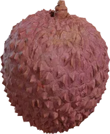</a> <b><a href="food_lychee_01">Food Lychee 01</a></b> by Oliver Harries · <a href="https://polyhaven.com/a/food_lychee_01">source</a> | <a href="food_pears_asian_01">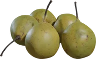</a> <b><a href="food_pears_asian_01">Pears Asian 01</a></b> by Amal Kumar · <a href="https://polyhaven.com/a/food_pears_asian_01">source</a> |
| <a href="food_pomegranate_01">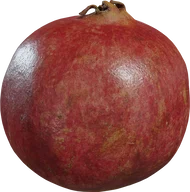</a> <b><a href="food_pomegranate_01">Food Pomegranate 01</a></b> by Oliver Harries · <a href="https://polyhaven.com/a/food_pomegranate_01">source</a> | <a href="hamburger_buns">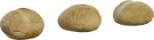</a> <b><a href="hamburger_buns">Hamburger Buns</a></b> by Alexander Shulha · <a href="https://polyhaven.com/a/hamburger_buns">source</a> | <a href="jug_01">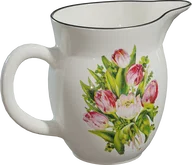</a> <b><a href="jug_01">Jug 01</a></b> by Kuutti Siitonen · <a href="https://polyhaven.com/a/jug_01">source</a> | <a href="lemon">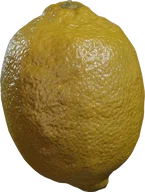</a> <b><a href="lemon">Lemon</a></b> by Kuutti Siitonen · <a href="https://polyhaven.com/a/lemon">source</a> |
| <a href="long_life_food">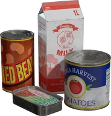</a> <b><a href="long_life_food">Long Life Food</a></b> by Mia Pecina Zorko · <a href="https://polyhaven.com/a/long_life_food">source</a> |  <b><a href="metal_jug">Metal Jug</a></b> by Anzor Lezhava · <a href="https://polyhaven.com/a/metal_jug">source</a> |  <b><a href="modified_thermos">Modified Thermos</a></b> by Alex Weber · <a href="https://polyhaven.com/a/modified_thermos">source</a> |  <b><a href="plastic_thermos">Plastic Thermos</a></b> by PierreB3D · <a href="https://polyhaven.com/a/plastic_thermos">source</a> |
| <a href="pot_enamel_01">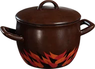</a> <b><a href="pot_enamel_01">Pot Enamel 01</a></b> by Kuutti Siitonen · <a href="https://polyhaven.com/a/pot_enamel_01">source</a> | <a href="russian_food_cans_01">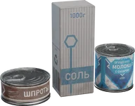</a> <b><a href="russian_food_cans_01">Russian Food Cans 01</a></b> by Kosan Aziz · <a href="https://polyhaven.com/a/russian_food_cans_01">source</a> | <a href="strawberry_chocolate_cake">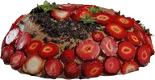</a> <b><a href="strawberry_chocolate_cake">Strawberry Chocolate Cake</a></b> by Kuutti Siitonen · <a href="https://polyhaven.com/a/strawberry_chocolate_cake">source</a> |  <b><a href="sweet_potato">Sweet Potato</a></b> by Jan Martens · <a href="https://polyhaven.com/a/sweet_potato">source</a> |
| <a href="tea_set_01">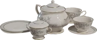</a> <b><a href="tea_set_01">Tea Set 01</a></b> by James Ray Cock, Jurita Burger, Rico Cilliers · <a href="https://polyhaven.com/a/tea_set_01">source</a> |  <b><a href="wine_bottles_01">Wine Bottles 01</a></b> by Jurita Burger, Rico Cilliers · <a href="https://polyhaven.com/a/wine_bottles_01">source</a> |  <b><a href="wooden_bowl_01">Wooden Bowl 01</a></b> by Oliver Harries · <a href="https://polyhaven.com/a/wooden_bowl_01">source</a> | <a href="wooden_bowl_02">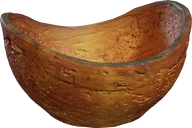</a> <b><a href="wooden_bowl_02">Wooden Bowl 02</a></b> by Kuutti Siitonen · <a href="https://polyhaven.com/a/wooden_bowl_02">source</a> |
| <a href="wooden_cutting_board">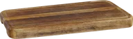</a> <b><a href="wooden_cutting_board">Wooden Cutting Board</a></b> by Kuutti Siitonen · <a href="https://polyhaven.com/a/wooden_cutting_board">source</a> |  <b><a href="wooden_spoon">Wooden Spoon</a></b> by Ronnie Barter · <a href="https://polyhaven.com/a/wooden_spoon">source</a> |  <b><a href="yellow_onion">Yellow Onion</a></b> by Kuutti Siitonen · <a href="https://polyhaven.com/a/yellow_onion">source</a> |  |

---

Kept up to date by this repository's own [update workflow](.github/workflows/update.yml), with code and plan from [cc0-mirror](https://github.com/zuujis-cc0/cc0-mirror). Something wrong? [Open an issue there](https://github.com/zuujis-cc0/cc0-mirror/issues/new) or use the [private report form](https://games.zuujis.com/report).
